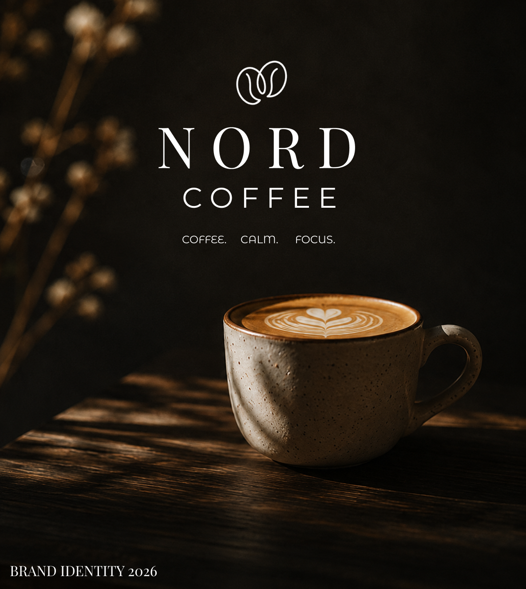
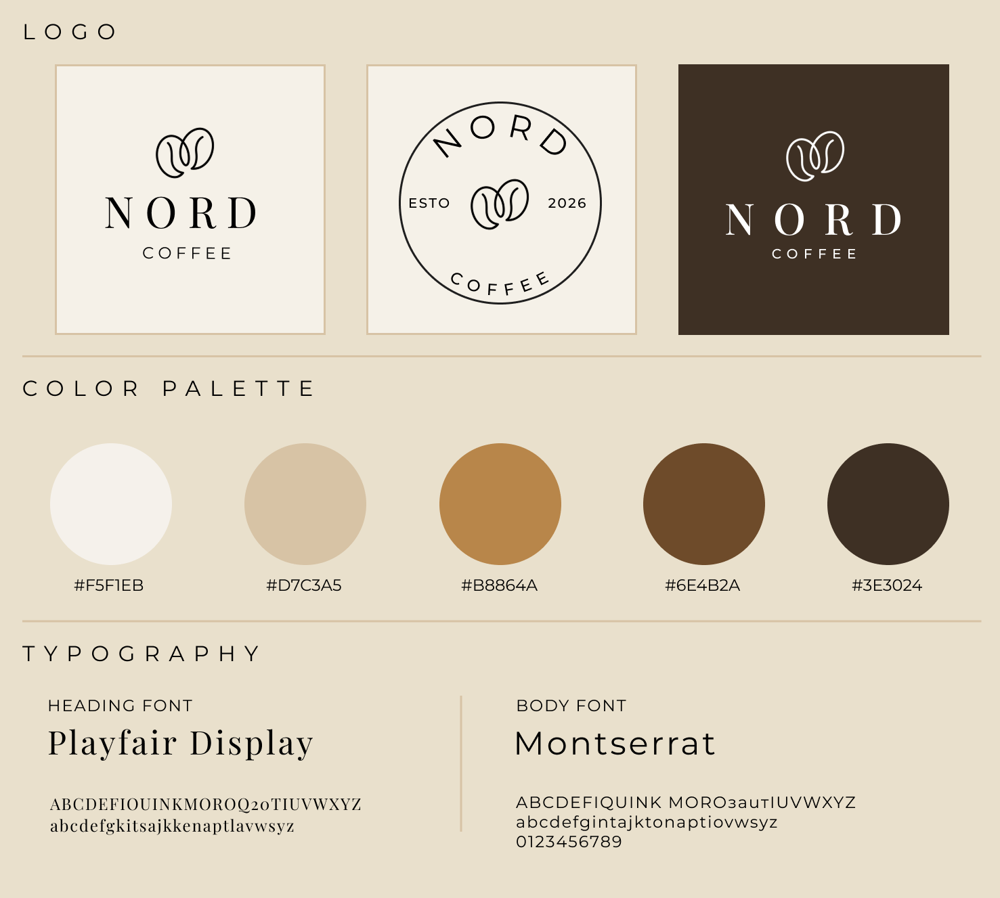
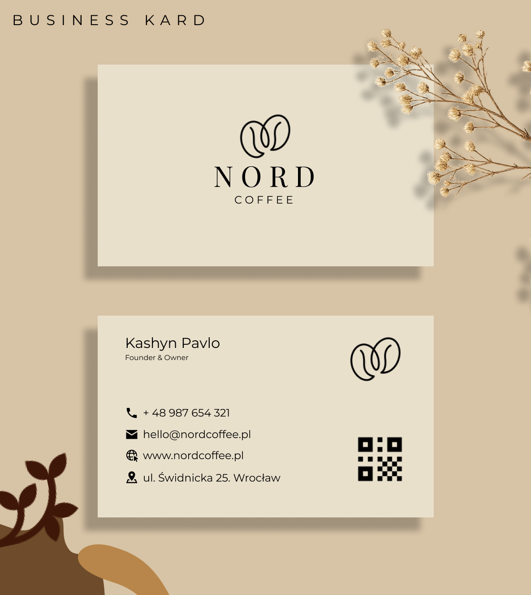
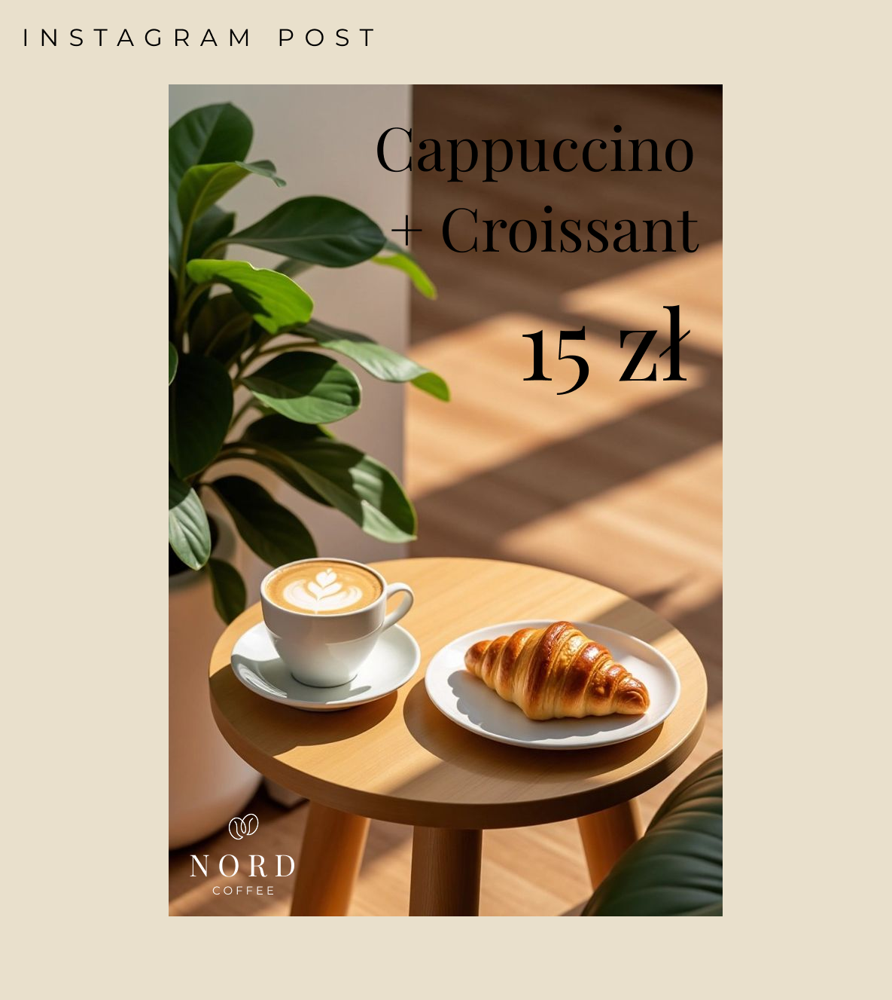
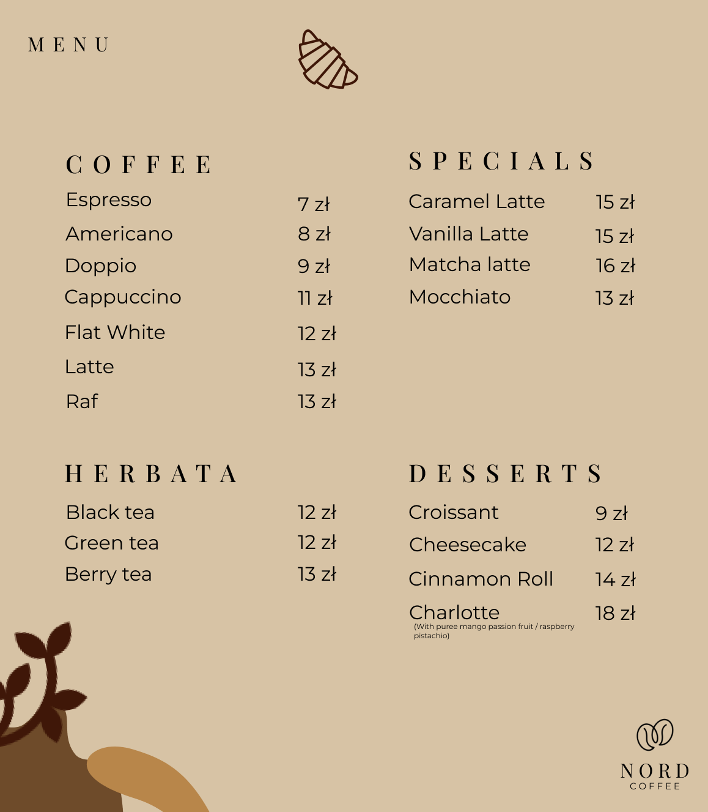
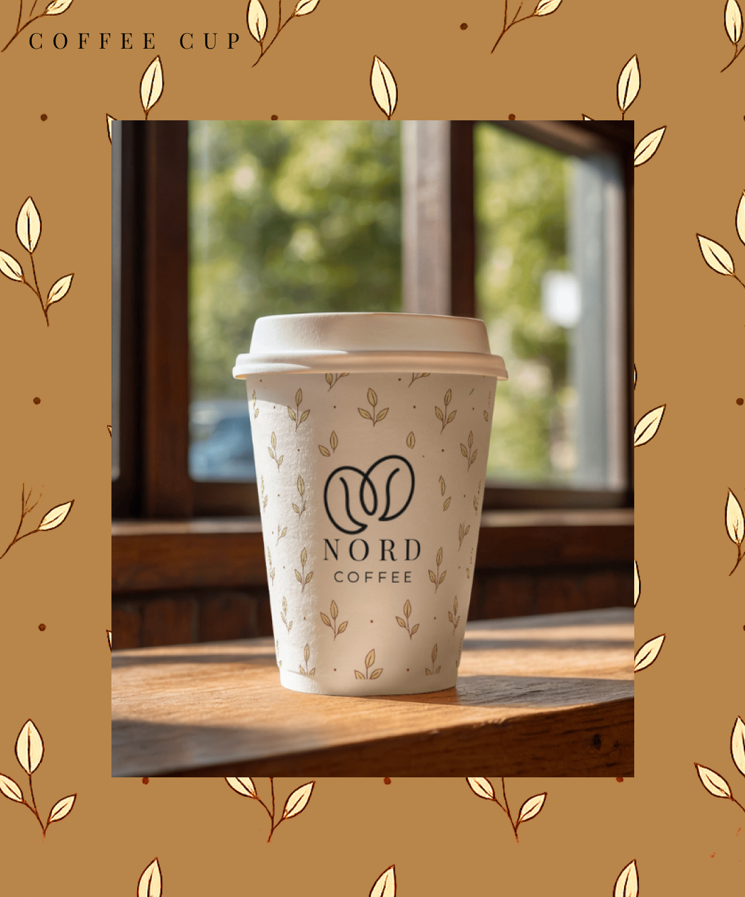
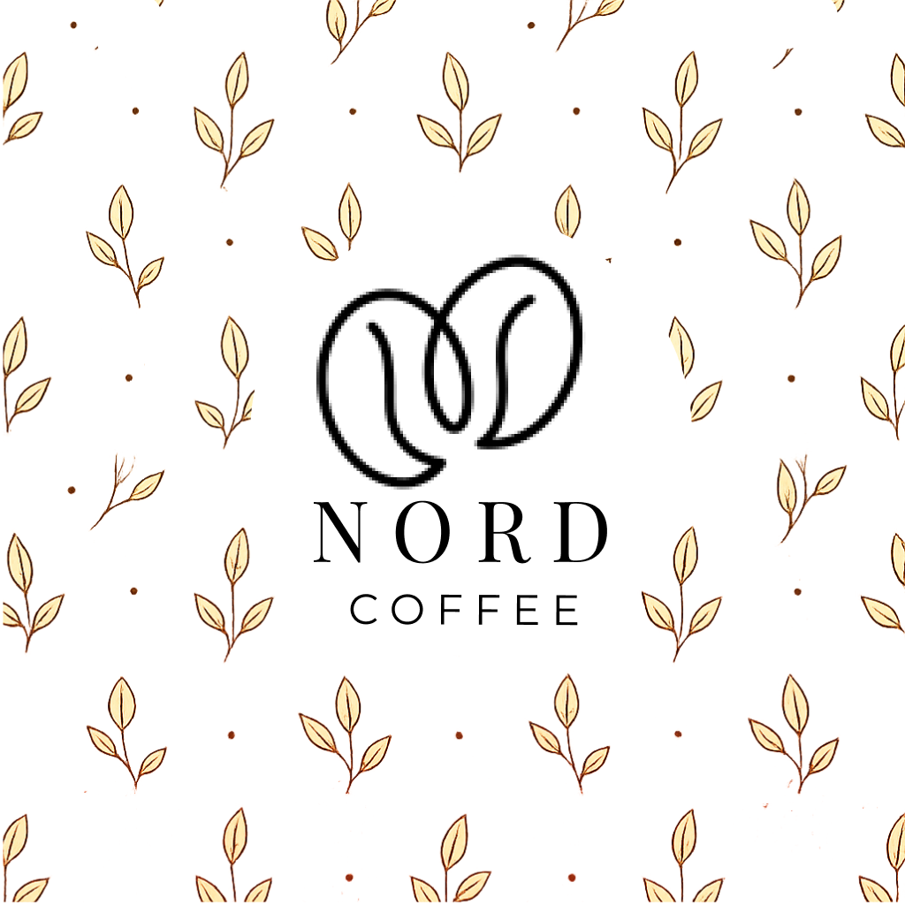

# NORD KOFFEE — Coffee Brand Identity

**Portfolio concept · PANTIK / Pavel Kashyn**

A coffee brand identity concept with a warm neutral palette and an understated editorial feel. Includes logo variations, colours, typography, business cards and promotional applications.

## Gallery

## About

Presented as a design concept for portfolio purposes. Brand names, sample contact details and promotional offers shown in the visuals are part of the concepts.

This repository contains image exports. Editable design source files are not included.

[Portfolio](https://pantikdesign.pages.dev/) · [Behance](https://www.behance.net/paveldesigns) · [Contact](https://t.me/pk_designstudio)
